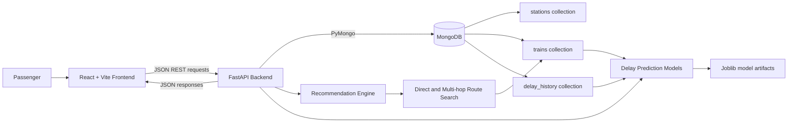
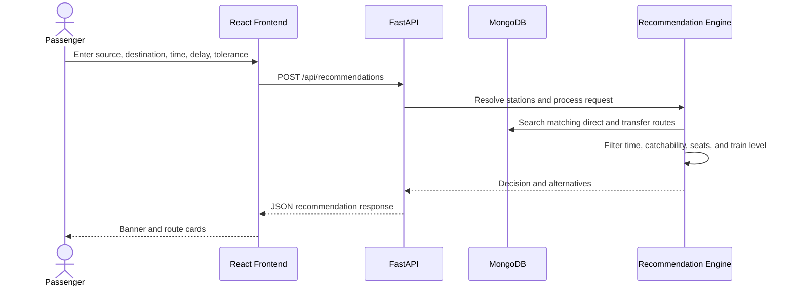

# RailSense – Railway Alternative Train Recommendation System

RailSense is a full-stack railway decision support system that helps a passenger decide whether to wait for a delayed booked train or switch to a better direct or two-leg alternative. It combines a rule-based route and timing engine with a machine-learning delay prediction panel.

The project uses a React frontend, a Python FastAPI backend, local MongoDB data, and scikit-learn machine-learning models.

---

## 1. Project Overview

When a booked train is delayed, a passenger may need to know:

- Should the passenger wait for the booked train?
- Is another direct train able to reach the destination earlier?
- Is a local or passenger train available as a fallback?
- Is a one-transfer route practical?
- Is the alternative train scheduled to depart soon enough?
- Are seats available in at least one booking class?

RailSense answers these questions by accepting journey details and an expected delay. The backend searches the stored Indian Railways timetable, filters candidates by date/time, classifies alternatives into three levels, and returns JSON results to the React interface.

The project also predicts the likelihood and possible range of delay for a future train date.

## 2. Problem Statement

Railway passengers commonly receive a delay update without an easy way to decide whether it is better to wait or change trains. Manual timetable searches do not combine:

- The booked train's scheduled arrival
- The expected delay
- The passenger's waiting tolerance
- Catchable departure times
- Seat availability
- Direct and transfer route options

### Proposed Solution

RailSense calculates the new expected arrival, compares it with the passenger's tolerance, searches direct trains and then two-leg routes, and applies strict timing and seat-availability checks. It returns a simple decision:

- Continue with the booked train
- Use a Level 1, Level 2, or Level 3 alternative
- No alternative is available

## 3. Objectives

- Accept source, destination, scheduled date/time, delay, and wait tolerance
- Exclude the booked train from alternative suggestions
- Recommend direct premium or express trains first
- Fall back to direct passenger/local trains
- Search practical two-leg routes as a final alternative
- Show station sequences, timings, and mock class-wise seat availability
- Predict future train delay probability and an estimated delay range
- Provide an interactive React dashboard and documented REST API

## 4. Key Features

- Station autocomplete using a local station catalog
- Booked-train selection and exclusion
- Date-aware ISO datetime handling
- Three-level recommendation hierarchy
- 10-minute catch buffer for candidate departures
- Maximum 180-minute waiting/layover guard
- Minimum layover setting for transfer routes
- Strict backtracking prevention for transfer routes
- Haversine distance guard for unreasonable transfer distances
- Mock seat availability by train type and class
- Future delay classification and regression
- FastAPI Swagger/OpenAPI documentation at `/docs`
- Dark React interface with direct and transfer route cards

## 5. Technology Stack

### Frontend

- React 19
- Vite 6
- Tailwind CSS 4
- Lucide React
- Fetch API
- `clsx` and `tailwind-merge`

### Backend

- Python
- FastAPI
- Uvicorn
- Pydantic
- PyMongo

### Database

- MongoDB Community Server
- Database: `train_recommendation_system`
- Collections: `stations`, `trains`, `delay_history`

### Machine Learning

- pandas
- scikit-learn
- joblib
- `HistGradientBoostingClassifier`
- `HistGradientBoostingRegressor`

The source code does not provide a `requirements.txt`, `pyproject.toml`, or a pinned Python environment file.

## 6. System Architecture



### Backend Architecture

The backend entry point is [`main.py`](main.py). It:

1. Starts a MongoDB client against `mongodb://localhost:27017`
2. Pings MongoDB at startup
3. Opens the `train_recommendation_system` database
4. Loads or preloads the classifier, regressor, and feature columns
5. Registers CORS for `http://localhost:3000` and `http://localhost:5173`
6. Exposes health, recommendation, station, train, and delay prediction endpoints

### Frontend Architecture

The frontend entry point is [`src/main.jsx`](src/main.jsx). [`src/App.jsx`](src/App.jsx) coordinates health status, journey submission, recommendation results, API errors, and future-delay prediction.

Key UI modules:

- [`src/components/RecommendationForm.jsx`](src/components/RecommendationForm.jsx) – journey inputs and presets
- [`src/components/StationAutocomplete.jsx`](src/components/StationAutocomplete.jsx) – station code/name search
- [`src/components/AlternativeCard.jsx`](src/components/AlternativeCard.jsx) – direct and transfer result cards
- [`src/components/DecisionBanner.jsx`](src/components/DecisionBanner.jsx) – decision status
- [`src/components/DelayPredictionPanel.jsx`](src/components/DelayPredictionPanel.jsx) – delay prediction controls
- [`src/lib/api.js`](src/lib/api.js) – Fetch API client

## 7. Complete System Workflow



### Step-by-Step Logic

1. The user selects source and destination stations. Stations can be searched by code or name.
2. The user enters a scheduled date/time, expected delay, wait tolerance, and optionally a booked train number.
3. The React frontend creates an ISO datetime such as `2026-11-15T06:30:00`.
4. If delay is at or below wait tolerance, the frontend can stop and display `continue_with_booked_train` without calling the recommendation API.
5. For an API request, [`recommend.py`](recommend.py) resolves station names and aliases and computes:

   ```text
   delayed arrival = scheduled date/time + delay minutes
   ```

6. [`route_search.py`](route_search.py) finds direct trains whose route contains the source before the destination.
7. Direct candidates are tested over day offsets `-1`, `0`, and `1` to handle midnight and multi-day schedules.
8. A candidate is eligible only when:
   - Its calculated arrival is strictly after the scheduled arrival
   - Its calculated arrival is strictly before the delayed arrival
   - Its departure is at least 10 minutes after the current wall-clock time
   - The departure wait is no more than 180 minutes
9. [`seat_availability.py`](seat_availability.py) generates mock class-wise availability. An option is discarded if every class has zero seats.
10. Eligible direct trains are divided into Level 1 and Level 2.
11. Level 1 is returned if any option survives. Otherwise Level 2 is returned.
12. If neither direct level has a valid option, the backend searches two-leg routes.
13. Transfer routes require:
    - A minimum layover of 30 minutes by default
    - A maximum layover of 180 minutes
    - A practical Haversine distance guard
    - No backtracking station overlap
    - Different leg trains
    - Seat availability on both legs
14. Level 3 routes are sorted by total duration and capped to the top 10 by route search.
15. The frontend renders the final JSON as direct route cards or two-leg transfer cards.

## 8. Machine Learning Implementation

The ML implementation is in [`delay_prediction.py`](delay_prediction.py).

### Dataset

Historical records are loaded from MongoDB collection `delay_history`. The source CSV is [`dataset/ir_train.csv`](dataset/ir_train.csv), with 1,500,000 rows verified in the current project. The field dictionary is [`dataset/ir_data_dictionary.csv`](dataset/ir_data_dictionary.csv).

### Preventing Leakage

The training code explicitly excludes runtime fields such as:

- Seat utilisation
- Overload status
- Late incoming rake
- Loco and coach age
- Rake sharing
- Maintenance score
- Primary delay cause
- Journey ID
- Departure date and year
- The target fields `delay_minutes` and `is_delayed`

The remaining features include date/time data and static route, train, zone, congestion, season, and infrastructure attributes.

### Classification Model

`HistGradientBoostingClassifier(max_iter=120, random_state=42)` predicts `is_delayed`, where `1` means a delay greater than 15 minutes according to the provided data dictionary.

### Regression Model

`HistGradientBoostingRegressor(max_iter=120, random_state=42)` predicts `delay_minutes` for records where `is_delayed == 1`.

### Prediction Flow

For a future date and train number:

1. Parse month and weekday.
2. Determine weekend and an approximate festival-season flag.
3. Approximate the season name.
4. Look up static metadata from `trains` or a matching `delay_history` record.
5. Build a raw feature row.
6. One-hot encode categorical features.
7. Reindex the row to the 90 saved feature columns.
8. Run the classifier's probability method.
9. Run the regressor.
10. Convert the prediction into a rounded confidence range.

Range policy in [`delay_prediction.py`](delay_prediction.py):

- Below 35% delay probability: lower bound `0`, upper bound 50% of predicted minutes
- 35% to below 70%: 70% to 120% of predicted minutes, plus 5
- 70% or above: 80% to 130% of predicted minutes, plus 15

### Verified Evaluation Metrics

The source code calculates classifier accuracy, classifier F1-score, regressor MAE, and regressor RMSE during retraining. **Recorded metric values are not found in the current source files or repository output.** The API uses the saved model artifacts and does not store a metrics JSON file.

## 9. Recommendation Logic

### Waiting Rule

```text
IF delay_minutes <= wait_tolerance_minutes
    continue_with_booked_train
```

Example:

```text
Delay: 20 minutes
Tolerance: 30 minutes
Result: continue with booked train
```

### Level 1 – Direct Express/Premium

Level 1 train types include Express, Superfast, Mail, Shatabdi, Jan Shatabdi, Rajdhani, Duronto, Garib Rath, Vande Bharat, Humsafar, Intercity, and similar aliases listed in [`recommend.py`](recommend.py).

### Level 2 – Direct Local/Passenger

Level 2 types include DEMU, MEMU, Passenger, Local, Commuter, and Toy/related aliases.

### Level 3 – Two-Leg Transfer

A transfer result includes:

- Leg 1 train and station sequence
- Transfer station code and name
- Minimum/actual layover
- Leg 2 train and station sequence
- Total journey duration
- Separate mock seat availability for both legs

Level 3 is considered only after Levels 1 and 2 fail.

### Ranking

- Direct alternatives are sorted by `durationMinutes`
- Transfer alternatives are sorted by `totalDurationMinutes`
- Route search deduplicates transfer station paths and keeps the fastest path

## 10. API Endpoints

The interactive documentation is available at `http://localhost:8000/docs`.

### `GET /api/health`

Checks API status and MongoDB connectivity.

```powershell
Invoke-RestMethod -Uri "http://localhost:8000/api/health"
```

Example response:

```json
{
  "status": "ok",
  "mongodb_connected": true
}
```

### `GET /api/stations/search?query=<text>`

Performs a case-insensitive partial match against station code or name and returns at most 10 records.

```powershell
Invoke-RestMethod -Uri "http://localhost:8000/api/stations/search?query=jammu"
```

Example response:

```json
[
  {
    "code": "JAT",
    "name": "JAMMU TAWI",
    "state": "Jammu and Kashmir"
  }
]
```

### `POST /api/recommendations`

Processes a recommendation request.

```json
{
  "source_code": "JAT",
  "destination_code": "UHP",
  "scheduled_time": "2026-11-15T06:30:00",
  "delay_minutes": 120,
  "wait_tolerance_minutes": 30,
  "current_time": "2026-11-15T05:00:00",
  "min_layover_minutes": 30,
  "booked_train_number": "12445"
}
```

```powershell
$body = @{
  source_code = "JAT"
  destination_code = "UHP"
  scheduled_time = "2026-11-15T06:30:00"
  delay_minutes = 120
  wait_tolerance_minutes = 30
  current_time = "2026-11-15T05:00:00"
  min_layover_minutes = 30
  booked_train_number = "12445"
} | ConvertTo-Json

Invoke-RestMethod -Method Post -Uri "http://localhost:8000/api/recommendations" -ContentType "application/json" -Body $body
```

Possible decisions:

```text
continue_with_booked_train
alternative_found
no_alternative_available
```

### `POST /api/predict-delay`

Predicts delay probability and delay range.

```json
{
  "train_number": "04601",
  "future_date": "2026-11-15"
}
```

Verified live sample response:

```json
{
  "train_number": "04601",
  "train_name": "Jammu Tawi Udhampur Special",
  "future_date": "2026-11-15",
  "delay_probability_pct": 91.2,
  "predicted_delay_range_minutes": [102, 180],
  "confidence_note": "High probability of delay expected based on seasonal and zone congestion indices."
}
```

### `GET /api/trains/{train_number}`

Returns the complete matching train document. The implementation tries the exact string and an integer-style alternative for numeric train numbers.

```powershell
Invoke-RestMethod -Uri "http://localhost:8000/api/trains/04601"
```

## 11. Database Design

MongoDB database: `train_recommendation_system`

### `stations`

Imported from [`dataset/stations_clean.json`](dataset/stations_clean.json).

Verified example fields:

| Field | Type | Purpose |
|---|---|---|
| `code` | String | Unique station code; unique index |
| `name` | String | Station name |
| `state` | String | State or territory |
| `zone` | String | Railway zone |
| `address` | String | Station address |
| `coordinates` | Object | Longitude and latitude |
| `coordinates.longitude` | Number | Longitude |
| `coordinates.latitude` | Number | Latitude |

The station cleaner removes records with code prefix `XX-`, zero coordinates, or duplicate codes.

### `trains`

Imported from [`dataset/trains.json`](dataset/trains.json).

| Field | Type | Purpose |
|---|---|---|
| `trainNumber` | String/possibly numeric | Unique train number; unique index |
| `trainName` | String | Train name |
| `type` | String | Train category |
| `source` | Object | Source code and name |
| `destination` | Object | Destination code and name |
| `runningDays` | Object | Sunday-to-Saturday availability |
| `overallDistanceKm` | Number | Overall route distance |
| `completeOrderedRoute` | Array | Ordered station timetable |

Each `completeOrderedRoute` entry contains:

| Field | Type | Purpose |
|---|---|---|
| `sequence` | Number | Station route order |
| `stationCode` | String | Station code |
| `stationName` | String | Station name |
| `arrivalTime` | String or null | Arrival time |
| `departureTime` | String or null | Departure time |
| `journeyDay` | Number | Journey day index |
| `distance` | Number | Route distance |

### `delay_history`

Imported in chunks from [`dataset/ir_train.csv`](dataset/ir_train.csv).

Its 46 columns are described in [`dataset/ir_data_dictionary.csv`](dataset/ir_data_dictionary.csv). Important targets and targets-related fields are:

- `is_delayed`
- `delay_minutes`
- `primary_delay_cause`

Other common fields include train number, train type, date, month, weekday, route, zone, traction, congestion, season, station categories, on-time percentage, and runtime leakage fields.

### Verified Data Counts

- Clean stations: 8,697
- Trains: 5,208
- Delay history CSV rows: 1,500,000
- MongoDB collection counts: 8,697 stations, 5,208 trains, and 1,500,000 delay-history records
- Trains referencing missing cleaned station codes: 1,354, recorded in [`missing_stations_report.txt`](missing_stations_report.txt)

## 12. Data Collection and Processing

The project is offline-first and uses local/static railway datasets rather than a live third-party API:

1. [`clean_stations.py`](clean_stations.py) cleans [`dataset/stations.json`](dataset/stations.json) and writes [`dataset/stations_clean.json`](dataset/stations_clean.json).
2. [`generate_dropdown_data.py`](generate_dropdown_data.py) generates frontend station and train catalogs in [`src/data/stations.js`](src/data/stations.js) and [`src/data/trainCatalog.js`](src/data/trainCatalog.js).
3. [`import_to_mongo.py`](import_to_mongo.py) imports stations, trains, and delay history into MongoDB.
4. [`route_search.py`](route_search.py) extracts station sub-routes and calculates durations.
5. [`seat_availability.py`](seat_availability.py) produces synthetic/mock class availability because no live seat-inventory API is implemented.
6. [`delay_prediction.py`](delay_prediction.py) encodes and trains on historical delay records.

No live train-status, PNR, fare, or seat-inventory API was found in the current source code.

## 13. Project Folder Structure

```text
project_expo/
├── main.py                         FastAPI application and endpoints
├── recommend.py                    Active recommendation engine used by API
├── recommendation_engine.py        Alternative minute-based engine implementation
├── route_search.py                 Direct and multi-hop route search
├── seat_availability.py            Mock seat availability generator
├── delay_prediction.py             ML training and future prediction
├── import_to_mongo.py              MongoDB import utility
├── clean_stations.py               Station cleaning utility
├── generate_dropdown_data.py       Frontend catalog generator
├── test_api.py                     HTTP endpoint verification script
├── delay_classifier.pkl             Saved delay classifier
├── delay_regressor.pkl             Saved delay regressor
├── delay_feature_columns.pkl        Saved model feature names
├── dataset/
│   ├── stations.json
│   ├── stations_clean.json
│   ├── trains.json
│   ├── ir_train.csv
│   └── ir_data_dictionary.csv
├── src/
│   ├── App.jsx
│   ├── main.jsx
│   ├── index.css
│   ├── lib/api.js
│   ├── data/
│   │   ├── stations.js
│   │   └── trainCatalog.js
│   └── components/
│       ├── RecommendationForm.jsx
│       ├── StationAutocomplete.jsx
│       ├── AlternativeCard.jsx
│       ├── DecisionBanner.jsx
│       └── DelayPredictionPanel.jsx
├── tests/
│   └── test_recommend_same_train_filter.py
├── scratch/
│   └── Diagnostic and verification scripts
├── package.json
└── vite.config.js
```

## 14. Installation and Setup

### Prerequisites

- Windows
- Python 3.10 or newer
- Node.js and npm
- Local MongoDB server on port `27017`
- Internet access only for package installation

### 1. Clone or Open the Project

```powershell
cd C:\Users\shivu\OneDrive\Desktop\project_expo
```

### 2. Create a Python Environment

```powershell
python -m venv .venv
.venv\Scripts\Activate.ps1
```

If PowerShell blocks activation, run:

```powershell
Set-ExecutionPolicy -Scope Process -ExecutionPolicy Bypass
.venv\Scripts\Activate.ps1
```

### 3. Install Python Dependencies

```powershell
python -m pip install --upgrade pip
pip install fastapi "uvicorn[standard]" pydantic pymongo pandas scikit-learn joblib
```

### 4. Install Frontend Dependencies

```powershell
npm install
```

### 5. Start MongoDB

Ensure MongoDB is running on `mongodb://localhost:27017`.

### 6. Import the Data

```powershell
python import_to_mongo.py
```

This drops and recreates `stations`, `trains`, and `delay_history`, creates indexes, validates station references, and reports missing references.

Optional frontend catalog regeneration:

```powershell
python clean_stations.py
python generate_dropdown_data.py
```

## 15. How to Run the Project

Open two terminals.

### Terminal 1 – Backend

```powershell
.venv\Scripts\Activate.ps1
python main.py
```

The API runs at:

- API: `http://localhost:8000`
- Swagger: `http://localhost:8000/docs`

The backend loads saved model files if they exist. The startup code uses `force_retrain=False`.

### Terminal 2 – Frontend

```powershell
npm run dev
```

Open:

```text
http://localhost:5173
```

### Production Frontend Build

```powershell
npm run build
npm run preview
```

## 16. Sample Input and Output

### Frontend Preset Example

```text
Source: Jammu Tawi (JAT)
Destination: Udhampur (UHP)
Scheduled: 2026-11-15 06:30
Delay: 120 minutes
Tolerance: 30 minutes
Booked train: 12445
```

### Waiting Example

```json
{
  "decision": "continue_with_booked_train",
  "reason": "Expected delay of 20 minutes is within user wait tolerance of 30 minutes.",
  "delayed_arrival_time": "2026-11-15T08:30:00",
  "alternatives": []
}
```

### Recommendation Window Example

```json
{
  "scheduled_time": "2026-11-15T06:30:00",
  "delay_minutes": 120,
  "wait_tolerance_minutes": 30
}
```

Calculated delayed arrival:

```text
2026-11-15T08:30:00
```

A direct train may qualify only if it:

- Arrives after 06:30
- Arrives before 08:30
- Departs at least 10 minutes after the current time
- Has at least one class with seats above zero

A live JAT-to-UHP sample request returned:

```json
{
  "decision": "no_alternative_available",
  "delayed_arrival_time": "2026-11-15T08:30:00",
  "alternatives": [],
  "reason": "No valid alternative found within the delay window."
}
```

### Future Delay Example

```json
{
  "train_number": "04601",
  "future_date": "2026-11-15",
  "delay_probability_pct": 91.2,
  "predicted_delay_range_minutes": [102, 180]
}
```

## 17. Testing and Results

### Frontend Build

Command:

```powershell
npm run build
```

Verified result:

- Vite production build completed successfully
- 37 modules transformed
- Build output written to `dist/`
- Vite reported a bundle-size warning for the main JavaScript chunk

### Unit Test

Command:

```powershell
python -m unittest tests/test_recommend_same_train_filter.py -v
```

Verified result:

- 1 test run
- 1 test passed
- The test confirms that a train selected as the booked train is excluded from alternatives

### Live API Checks

Verified against a running local FastAPI and MongoDB instance:

| Check | Result |
|---|---|
| `GET /api/health` | `status: ok`, `mongodb_connected: true` |
| `GET /api/stations/search?query=jammu` | Returned JAT and VJPJ |
| `GET /api/trains/04601` | Returned 04601 train metadata |
| `POST /api/predict-delay` | Returned 91.2% probability and 102–180 minute range for the verified sample |
| `POST /api/recommendations` | Returned `no_alternative_available` for the JAT-to-UHP sample tested |

### HTTP Test Script

[`test_api.py`](test_api.py) is a manual endpoint test suite that prints status and JSON for all five endpoints. Start the backend first, then run:

```powershell
python test_api.py
```

### Available Scratch Checks

The `scratch/` directory contains route, gap, and integration diagnostic scripts. These are verification tools, not the main application entry points.

## 18. Limitations

- Seat availability is randomly generated mock data, not live inventory.
- Seat values may change on repeated calls because the generator uses random utilisation and noise.
- The delay predictor is not a live train-status system.
- The future prediction relies on a matching historical record or default feature values.
- Historical data may not represent current real-world operating conditions.
- There is no authentication or role management.
- The backend and MongoDB are configured for local development only.
- CORS is limited to localhost ports 3000 and 5173.
- The source code has no root `requirements.txt` or pinned Python dependencies.
- ML training metrics are computed in code, but historical values are not stored or documented.
- [`seat_availability.py`](seat_availability.py) uses `DEFAULT_TRAIN_TYPE` in one fallback branch, but that constant is not defined in the current file. Unknown train types may therefore raise an error instead of receiving a fallback capacity map.
- [`missing_stations_report.txt`](missing_stations_report.txt) shows that 1,354 trains reference codes absent from the cleaned station list.
- Running the import script intentionally drops and recreates all three MongoDB collections.
- `recommendation_engine.py` contains an older minute-based engine, while the API uses `recommend.py` and its ISO-datetime logic.
- The project does not store user searches or recommendation history.
- No public deployment configuration was found.

## 19. Future Enhancements

- Connect live train delay, PNR, and seat-availability APIs
- Add caching for station and route searches
- Persist recommendation history
- Validate and improve unknown train-type handling
- Add authentication and user profiles
- Add test coverage for Level 1, Level 2, Level 3, and fallback decisions
- Store ML evaluation metrics and model versions
- Add automated model retraining and data drift checks
- Use a timezone-aware date/time library
- Add running-day filtering
- Add passenger class selection
- Add ticket fare and coach information
- Add Docker Compose for React, FastAPI, and MongoDB
- Add environment-based configuration for MongoDB and frontend API URL
- Reduce frontend bundle size with route or component splitting
- Add a trained model download/build pipeline

## 20. Author Details

**Author Name:** Not found in the current source code  
**Project Name:** RailSense – Railway Alternative Train Recommendation System  
**Purpose:** Academic/portfolio railway decision support and machine-learning demonstration project
